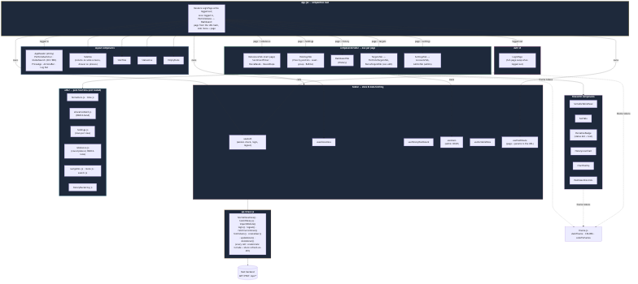

# Frontend

React 19 + MUI + Recharts single-page app for the Wallet Allocations dashboard. For project-wide setup (backend, database, running both halves together), see the [root README](../README.md#frontend-react-setup).

```bash
npm install
npm run dev      # start the dev server
npm run test     # run the Vitest suite
npm run lint     # eslint
npm run build    # production build
```

Copy `.env.example` to `.env.local` if the backend isn't running on the default `http://localhost:3001`.

---

## Architecture

`App.jsx` is a thin composition root — it renders `LoginPage` while logged out, or, once `useAuth` resolves a session, the side menu and the page named in the URL hash (`#/holdings?view=barca`, via `useHashRoute`), so a reload, a bookmark or Back keep your place. No business logic lives in a component: table math is in `utils/`, data fetching is in `hooks/`, and styling tokens are in `theme.js`.

Source: [`docs/architecture.mmd`](docs/architecture.mmd)



### Key components structure

| Layer | Path | Responsibility |
|---|---|---|
| Composition root | `src/App.jsx` | Picks the page from the URL (`resolvePage` falls back to Holdings for an unknown or hidden page), lays out the side menu (a drawer on phones) and wires data into pages. Nothing here renders a table row directly. |
| Auth UI | `src/components/LoginPage.jsx` | Full-page swap shown whenever there's no session — there's no router, so "logged out" is just a different thing `App.jsx` renders. |
| Layout | `src/components/AppHeader.jsx`, `SideNav.jsx`, `GlobalSearch.jsx`, `PricesAge.jsx`, `ActionsBar.jsx`, `StatTiles.jsx`, `StatusLine.jsx`, `EmptyState.jsx` | The page chrome: sticky header (account switcher, search with Ctrl/⌘K, prices age, import/export naming the account, Log Out), the side menu, KPI tiles, empty/loading affordances. |
| Pages | `src/components/tabs/*.jsx` | One component per menu entry: `RebalanceTab` (start page: BARCA bands, the sentiment question, this round's steps from `utils/rebalance.js`, `RecordTradeDialog` to record a trade made on an exchange, pre-filled from a step, and `MoveBalanceDialog` to move a quantity to another BARCA and/or exchange; their pure logic is `utils/trade.js` and `utils/move.js`), `HoldingsTab` (one table, "View by" position / asset / group / BARCA, filter, "only outside band"), `DashboardTab` (History), `TargetsTab` (asset + BARCA targets), `SettingsTab` (Accounts + Users). Which entries a user sees is decided once in `utils/navigation.js`. |
| Shared UI | `src/components/{SortableTableHead,SubTabs,DeviationBadge,HistoryLineChart,ChartTooltip,DashboardControls}.jsx` | Reusable pieces — a generic sortable header, page sub-tabs, the colored-dot deviation indicator, and the chart wrappers. |
| Hooks | `src/hooks/{useAuth,useAllocations,usePositionSources,useHashRoute,useHistoryDashboard,useUsers,useSortableData}.js` | All `useState`/`useEffect`/data-fetching. `useAuth` owns the session; `useAllocations` polls the live allocations; `useHashRoute` keeps the page and its options in the URL; `useUsers` is `AdminTab`'s CRUD. |
| Utils | `src/utils/{formatters,time,allocationMath,holdings,rebalance,trade,move,navigation,route,search,pricesAge,historyBucketing}.js` | Pure functions only — no React, no DOM: the BARCA band rule, the round planner (BARCA rules 1–3), Holdings rows per view (with the DCA step's direction), who sees which page, URL parsing, search matching. Unit-tested next to each file. |
| API | `src/api/client.js` | The only place that calls `fetch()`. Every call sets `credentials: "include"` (so the session cookie is sent) and transparently retries once via `/api/auth/refresh` on a 401. `VITE_API_BASE_URL` (see `.env.example`) points it at the backend. |
| Theme | `src/theme.js` | The dark MUI theme, the fixed 8-color categorical palette, and `colorForSeries()` — see [Design system](#design-system) below. |

### Testing

Vitest + React Testing Library. Pure logic in `utils/`, `theme.js`'s `colorForSeries`, and the hooks (including `useAuth`, `useAllocations` polling and `useHashRoute`, with the backend mocked) have direct unit tests; `HoldingsTab`, `GlobalSearch`, `SideNav`, `SettingsTab`, `LoginPage`, `AdminTab` and others have component tests exercising real interaction (typing, clicking, confirming a delete). Run with `npm run test`. There's no end-to-end browser test — the golden path and edge cases (login, role-gated menu, search, Holdings views and filters, sorting, CSV import, every page) are verified manually against a running backend before every change of this size.

---

## Authentication

There's no router and no self-registration — `App.jsx` just renders `LoginPage` instead of the dashboard whenever `useAuth`'s session check comes back empty, and `AdminTab` only renders as a 6th tab when the logged-in user's role is `admin`. See the root README's [Authentication & Authorization](../README.md#authentication--authorization) for the backend side of the handshake and the full sequence diagram.

- The session lives in `HttpOnly` cookies the browser manages automatically — the frontend never reads or stores a token itself.
- `ActionsBar` hides (not just disables) "Import Wallet CSV" for the `user` role, so the permission boundary is visible rather than a button that would just 403.
- An expired access token is invisible to the rest of the app: `api/client.js` retries once through `/api/auth/refresh` before surfacing any error.

---

## Design system

The UI follows a validated dark-theme palette rather than MUI's stock `mode: "dark"` defaults — see `theme.js` for the full token set.

- **Categorical color is fixed-order, not cycled by array index.** `colorForSeries(name, allSeries)` resolves a color from an entity's position in the *full* sorted series list, not its position in whatever subset is currently selected/filtered — so removing a filter never repaints the series that survive it.
- **Status colors (`good`/`warning`/`critical`) are reserved** for deviation severity (`DeviationBadge`) and never reused as a chart series color, so a red line and a "critical deviation" cell never look like the same signal.
- **Known trade-off**: the fixed palette has 8 hues. With ~30 possible assets, an arbitrary 5-series default (see below) can occasionally repeat a color. This is an accepted limit of a fixed categorical palette, not a bug — narrow the Dashboard's Series picker to avoid it when it matters.
- **The Dashboard's "Assets"/"BARCA"/"Groups" levels default to the top 5 series by value**, not every series — a line chart with 30 overlapping series is unreadable regardless of color choice; the multi-select still allows picking any subset.
- Numeric table columns use `font-variant-numeric: tabular-nums` so digits align vertically down a column.
- **Band colors follow BARCA rule 1**: `bandStatus()` says whether a row is more than 20% of its own target above it (green, `BAND_COLORS.above`) or below it (red, `BAND_COLORS.below`); in band has no color. Value held with no target counts as above. The shades are lighter than `STATUS_COLORS` so small text passes WCAG AA on the dark cards.
- Times are always shown in BRT (`utils/time.js`), converted from the API's UTC timestamps — never by subtracting hours from a local time.
- A deviation reading is never color-only: `DeviationBadge` always pairs the color with a visible dot and the text itself, for colorblind-safe reading.
